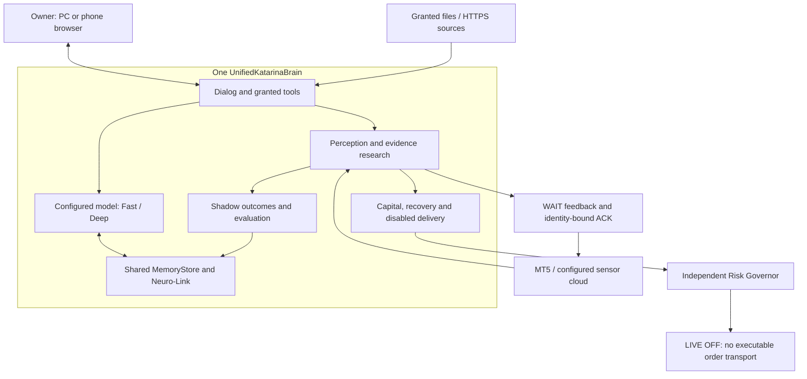

# Katarina AI: target diagram and pretrial implementation

16 October 2026. Live execution remains disabled. Risk Governor stays outside the
brain. This change adds the dialog/tool surface and nonexecuting return path; it
is not a certification of a general AI, broker deployment, strategy or profit.

The WAIT return path terminates in the Python adapter/Hands bridge. It does NOT
call MQL5 execution, place an order, or prove a broker fill. Frozen KAT1 execution
and strategy/risk engines are untouched. Existing sensor clients remain valid;
`brain_feedback` is an additive, nonexecuting RPC.

## Run on a computer

Python 3.12 remains a prerequisite; the ZIP does not embed a Python runtime.

1. Run `SETUP_KATARINA.bat`, then `START_KATARINA.bat` for the existing PC test.
2. Run `python katarina_pc.py pretrial` for behavioral acceptance. Expected:
   `PASS_SYNTHETIC_PRETRIAL_ONLY`. Report paths are printed.
3. Copy `config/dialog_model.example.json` outside the source and replace model
   IDs and endpoint with your installed local model's JSON chat-completions
   service, or a compatible configured HTTPS service. The placeholder is not
   a working model and no model is downloaded automatically. Remote services
   receive prompts, relevant history, recalled research and granted tool output.
4. For a remote service, set the token through the environment variable named
   by `token_env`. Do not put secrets in prompts or the JSON config.
5. Run `python katarina_pc.py chat --model-config PATH`.
   Optional `--prompt "Periksa status Katarina"` runs one turn; `/keluar` exits.
   `--workspace PATH` explicitly grants UTF-8 file reads beneath that directory.
   `--sources-config PATH` grants HTTPS sources listed in a JSON object mapping
   source IDs to exact URLs (no query strings or credentials). This is document
   fetching, not a general web search engine. `--connection-config PATH` grants
   read-only observation of the specified account only.
6. Optional model connectivity test:
   `python katarina_pc.py pretrial --model-config PATH`.
   A response is connection evidence; its correctness still needs evaluation.

## PC and phone browser

Set `KATARINA_OWNER_TOKEN` to your own random secret of at least 32 ASCII
non-whitespace characters. Start:

`python katarina_pc.py ui --model-config PATH`

Open `http://127.0.0.1:8765` on the host PC. Enter the token in the password box.
The browser does not store it in localStorage, cookies or the URL. The process
runs in the foreground; Ctrl+C stops it and releases the brain lock.

For a phone on an authorized network, configure the host address and a valid
TLS certificate/key, then pass `--bind HOST_IP --cert CERT_PATH --key KEY_PATH`.
Open the HTTPS address on the phone. Non-loopback HTTP is refused. Firewall,
DNS, certificate trust and actual phone connectivity require destination-host
setup; the application does not open firewall ports or deploy itself. This is
a browser UI, not a native APK or standalone executable. The brain runs on the
configured host; it is not claimed to run locally on an arbitrary Android phone.
One Owner token grants that Owner's sessions; session IDs are conversation
labels, not separate authenticated user identities.

## How each turn works

User prompt -> bounded recall -> automatic Fast/Deep selection -> configured
model -> allowlisted tool -> inspect tool output -> response -> immutable dialog
record. At most four calls by default. Automatic routing is a deterministic
heuristic using input length and analysis/risk words, not a validated measure of
reasoning complexity. A missing/broken provider blocks the turn; it never falls
back to a fixture model. Model responses are marked unverified. Tools do not
include shell, source rewrite, install, credential retrieval or order execution.
No model or fetched page can add tools to its grants.

The dialog and sensor observation use the SAME brain instance and databases,
sequentially under the same host lock. No background workers are created.
History recall is a bounded recent window, not unlimited perfect recall. Dialog
statements are not promoted into independently validated Neuro-Link outcomes.
Tool provenance is stored with hashes; local digests detect corruption, not an
attacker able to rewrite the database and its hashes. Logs can contain user
prompts and explicitly granted file/source contents; protect the state directory.

## MT5 two-way acceptance

Incoming: bound terminal/account -> market/position/history sensor reads -> brain.
Outgoing: `WAIT_LIVE_OFF` + symbol + plan digest + ID + short expiry -> adapter
inbox -> matching acknowledgement -> brain memory/report. Identity is checked
before and after acknowledgement. Expired, conflicting, invalid and executable
messages are rejected. Cloud messages also bind session and request nonce.
No outbound BUY/SELL/CLOSE/MODIFY action is accepted. ACK is not broker execution.
The session cache retains unexpired IDs and ages out expired entries; reaching
capacity blocks new feedback rather than dropping active deduplication. Sensor reconnect/fallback remains bounded.

## Evidence and outstanding gates

Pretrial uses scripted model output and invented broker prices explicitly. It
checks real tool dispatch, file provenance, restart recall, denied order tools,
three-symbol sensing/feedback, independent risk veto and disabled delivery.
CI also tests malformed input, budgets, account changes, expired/conflicting
feedback, cloud session replacement and Owner HTTP authentication.

Still requiring real evidence:

- Configured model accuracy on unseen Indonesian tasks, hallucination rate,
  token usage, costs, latency and multi-step completion quality. No real model
  or credentials are bundled; unit fixtures do not establish intelligence.
- Configured MT5/Cloud Hands data, TLS, reconnect and feedback on the target host.
- Broker demo execution/fill/cancel/reprice/partial/trailing and reconciliation.
  Real execution remains deliberately unavailable in this release.
- Phone UI over real TLS/network, installed model compatibility and practical
  resource limits. No claims of native phone packaging or Python-free startup.
- Strategy holdouts, prospective costs, promotion/canary and rollback evidence.
  Remembered dialogue alone is not verified strategy learning.

No claim that this is the final possible repair: destination-host and prospective
acceptance may reveal defects. Do not interpret a synthetic PASS as live clearance.
