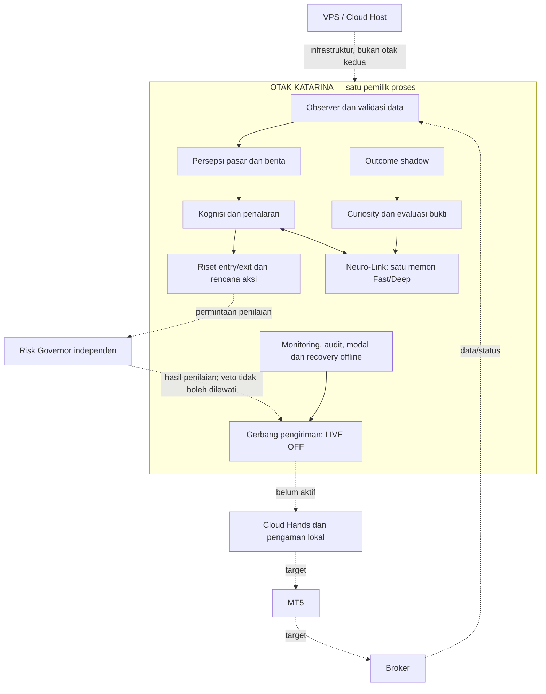

# Katarina — satu otak, satu pengelola proses

**Patokan arsitektur yang disetujui Owner, 16 Oktober 2026 (WIB).** Dokumen ini
menerapkan batas pada diagram terakhir dalam percakapan: semua proses internal
dimiliki `UnifiedKatarinaBrain`; Risk Governor tetap independen. Batas ini
menggantikan penggambaran observer sebagai proses terpisah pada diagram lama.
Keputusan risiko dan modal pada baseline/addendum 14 Oktober tetap berlaku;
pekerjaan ini tidak menetapkan parameter finansial atau SLO baru.

## Pemetaan yang mengikat implementasi

| Di dalam otak | Jalur aktual |
|---|---|
| Pemilik proses dan koneksi | `UnifiedKatarinaBrain.observe_once` |
| Observer, validasi, konteks pasar/berita | `brain_observer.BrainObserver`, kemampuan internal tanpa lifecycle sendiri |
| Persepsi | Instance `MarketDecisionBrain` milik otak, tanpa perubahan strategi |
| Kognisi, curiosity, memori bersama | `run_unified_cognitive_cycle` pada instance yang sama |
| Penyelesaian, pembelajaran dan sampling | `advance_shadow_cycle`: resolve → settle → learn → propose |
| Monitoring dan audit | `inspect_foundation`, `BrainRuntimeControl.audit_phase` |
| Modal dan Profit Lock | Engine modal lama di `brain.control.capital`, lingkup offline |
| Recovery posisi | Engine recovery lama di `brain.control.recovery`; hanya preview intent yang tidak dikirim |
| Penyimpanan checkpoint/audit | MemoryStore milik otak; checksum dan append-only tetap berlaku |
| Pengiriman | `DisabledDeliveryGate`: penilaian Risk Governor eksternal, kemudian selalu BLOCKED_LIVE_OFF |
| Peluncur kompatibilitas | `scripts/ai/run_contextual_market_observer.py`, hanya mendelegasikan satu pass |

`config/katarina_brain_boundary_v1.json` dan profil unified adalah kontrak mesin
yang diperiksa acceptance/CI. Registry mencakup 17 modul, bukan 17 otak/worker.
Tidak ada Risk Governor yang dibuat atau dimiliki otak; instance penilai harus
diberikan dari luar. Tidak ada callback order, antrean kirim ulang, sakelar enable,
loop background, worker tambahan atau scheduler baru pada jalur ini.

Cloud Hands, MT5, broker dan VPS tetap batas eksternal. Pembacaan broker dilakukan
melalui adapter yang diinjeksi; cold import tidak memerlukan MetaTrader5.
Local Survival Guardian tetap dekat dengan akun/Hands agar putus koneksi tidak
menghilangkan perlindungan lokal. VPS adalah infrastruktur, bukan tahap order.

## Lifecycle dan keselamatan

1. Ambil lock satu observer, lalu hubungkan adapter broker yang dipilih secara eksplisit.
2. Tolak terminal yang mengizinkan trading sebelum membuka state penelitian.
3. Otak memiliki satu ContextStore, satu MemoryStore, journal dan shadow book.
4. Evaluasi hanya data kausal, selesaikan outcome lama, pelajari, baru sampling virtual berikutnya.
5. Periksa ulang izin trading, history/provenance dan foundation sebelum publikasi atomik.
6. Catat COMPLETE atau BLOCKED tanpa pesan error sensitif; tutup memori, context,
   koneksi broker dan lock bahkan ketika salah satu cleanup gagal.

Dua peluncur lama (`run_market_brain.py` dan `run_decision_brain_v3.py`) sekarang
menolak dijalankan dengan `LEGACY_OBSERVER_DISABLED`. Perintah scheduled lama tidak
dialihkan diam-diam ke lokasi state lain dan tidak boleh memulai observer paralel.
Source helper candle yang dahulu diimpor dari script legacy telah dipindah ke
adapter read-only, sehingga jalur baru tidak menarik entry point lama.

Checkpoint baru berlabel `OFFLINE_BRAIN_RUNTIME_ONLY`. Restore divalidasi utuh
sebelum state diganti, mempertahankan reserve dan status inflight untuk menghindari
intent ganda. Health/connectivity selalu memerlukan fakta baru setelah restart.
Tidak ada migrasi saldo broker/legacy otomatis, tidak ada pelepasan reserve dan
tidak ada modifikasi posisi manual Owner. Engine modal, recovery, strategi,
konfigurasi risiko, Risk Governor dan source MT5 dipertahankan.

## Batas kelulusan

Yang selesai di source adalah kepemilikan dan urutan proses sesuai diagram.
Uji penuh menggunakan **broker sintetis**, bukan validasi broker nyata. Test juga
menolak terminal aktif, perubahan izin di tengah pass, sensor gagal, observer ganda,
publikasi yang melanggar no-orders, checkpoint rusak, reserve lama yang berbeda,
restore parsial, serta pengelolaan posisi manual. Persetujuan risk dalam simulasi
tetap tidak dapat melewati gerbang LIVE OFF dan tidak menghasilkan antrean retry.

Cloud auth/TLS/WSS, deployment dan sinkronisasi VPS, broker costs/fills,
parameter riset yang belum tervalidasi, serta routing Fast/Deep otomatis tetap
belum dianggap selesai. Tidak ada janji penghematan CPU/latensi tanpa pengukuran.
