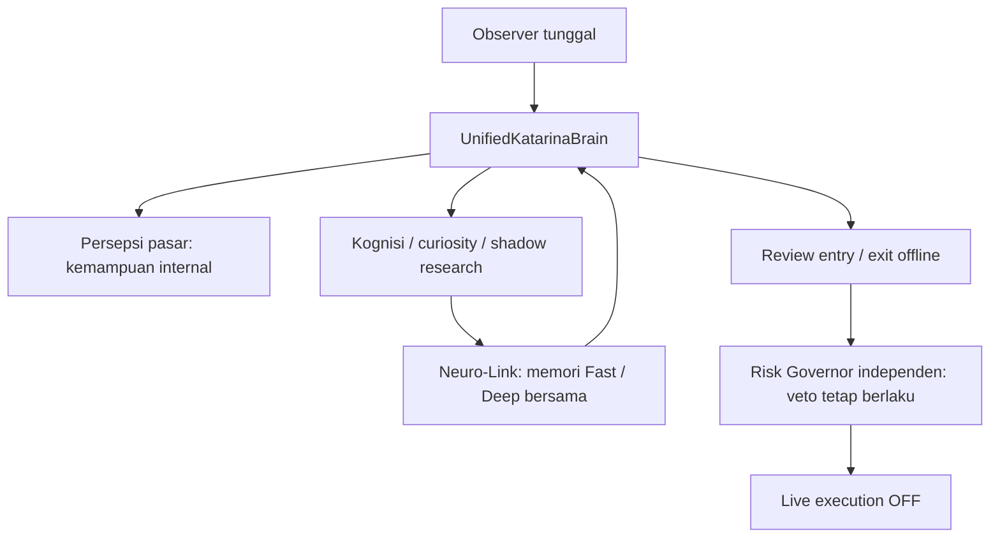

# Katarina V1 — satu pohon kode, satu jalur penelitian

## Sasaran timeline Owner (14 Oktober 2026)

1. **Hidupkan secara aman / satukan fondasi**: Core Orchestrator, data broker, modal, Risk Governor, recovery dan unified brain tetap satu codebase. **Katarina Management dan 11 spesialis dihapus** sesuai keputusan Owner terbaru; keduanya bukan dependensi acceptance Katarina AI. Tidak membuat EA atau otak kedua.
2. **Stabilkan dan sinkronkan**: satu *pinned* Git commit untuk kandidat integrasi dan isolated worktree VPS; jalur `github-main` yang punya perubahan Owner **tidak ditimpa**.
3. **Belajar dan bereksperimen**: observer tunggal mengalirkan hasil shadow quote yang telah selesai ke `self_evolution_lab`, kemudian mengubah hanya ambang pemilihan eksperimen berikutnya per symbol/metode/BUY/SELL/regime.
4. **Buktikan hasil**: data broker per-deal dan floating P/L asli, server trading-day, uji metode BUY/SELL terpisah, biaya trading aktual, pengujian prospektif forward dan demo. Jika hasil negatif, WAIT; jangan klaim profit.
5. **Rilis bertahap**: only with independent QA, human approval, and original hard Risk Governor. Trading live tidak otomatis diloloskan meski software build lulus.

## Profil terintegrasi saat ini

`config/katarina_unified_v1.json` adalah satu *deployment/acceptance profile* yang menunjuk ke **komponen lama yang sudah ada**, tidak menggantikan orchestrator atau menambah worker. Perintah:

```powershell
$env:PYTHONPATH = "src;."
py -3 -B scripts/ai/verify_unified_katarina.py
```

Perintah ini hanya memeriksa bahwa semua modul inti dapat diimpor, batas risiko final masih benar, dan brain/shadow bisa membaca SQLite. Tidak memanggil `mt5.initialize()`, tidak mengirim order, tidak memodifikasi database maupun menjadwalkan proses. Dengan parameter `--shadow-db`, SQLite lama dibuka **mode read-only**; ini bukan kelulusan live.

**Dihapus** berdasarkan keputusan Owner 15 Oktober: Management beserta 11 spesialis, script, workplan dan workflow pemanggilnya. Sejarah tetap tersedia di Git.

**Tetap dinonaktifkan** dalam profil: external-model coding workers, self-rewrite produksi, broker-provenance yang belum terverifikasi, server-clock yang belum terverifikasi, migrasi capital state otomatis, scheduler yang telah dibatalkan Owner, dan live execution. Data broker dan memori privat tidak dihapus. Penangguhan itu **tidak boleh menghapus fail-closed gate, mengubah Risk Governor atau menurunkan otorisasi live**.

### Konsistensi modal dan risiko

- Profit Lock = 25% dari realized balance saat milestone berlipat; cadangan tetap *logical reserve*, bukan dana yang sudah ditarik.
- 5% batas maksimum tiap entry, 8% maksimum total open risk lintas posisi Owner/Katarina.
- DD 10–23% caution; 23–35% hanya recovery yang memenuhi bukti; DD >=35% akibat Katarina/unknown → emergency lock. Owner-cause exception hanya dengan atribusi broker lengkap dan pemeriksaan risiko independen.
- Posisi manual Owner tak boleh dimodifikasi tanpa izin.
- Semua fitur produksi yang belum lolos tetap dimatikan; jangan mengubahnya menjadi mode live hanya untuk menyatakan proyek 'selesai'.

### Aturan sinkronisasi aman

1. Jalankan semua pengujian CI serta pemeriksaan **Unified Katarina AI** terhadap SHA yang sama. Management dan 11 spesialis tidak ada dalam runtime maupun CI.
2. Fetch SHA yang sudah diperiksa ke **worktree VPS terpisah**, jangan `reset --hard`, `clean`, atau `pull` pada `github-main` yang berisi perubahan lokal Owner.
3. Pastikan `git rev-parse HEAD` dan `git status --porcelain` dari worktree tersebut identik dengan SHA GitHub dan tidak ada perubahan lokal.
4. Jalankan checker read-only di worktree itu, lalu pastikan task terjadwal lama tetap Disabled, RAM cukup, dan MT5 tidak dinyalakan.
5. Hanya satukan perubahan ke `main` setelah seluruh pemeriksaan teknik, konflik dan persetujuan integrasi aman. Rilis live **terpisah** dan tetap blocked sampai data/forward siap.

**Keberhasilan integrasi software bukan pembuktian edge atau aktivasi trading.**

## Satu pintu masuk canonical — 15 Oktober 2026



`UnifiedKatarinaBrain` memiliki satu instance persepsi pasar, satu koneksi evidence
shadow dan satu MemoryStore knowledge. Observer memanggil instance yang sama
untuk persepsi dan pembelajaran sesudah settlement, sebelum proposal virtual.
Neuro-Link menyalin hanya outcome quote yang telah selesai, memberi label OBSERVED
(bukan bukti broker tervalidasi), mempertahankan provenance dan recall past-only.
Fast/Deep hanya memilih budget pencarian yang sudah ada pada memori yang sama.
Rollback, checkpoint usang dan jendela recall terpotong memblokir sampling baru.
Sintesis entry/exit tersedia pada instance yang sama sebagai riset offline.

Tidak ada worker/model trading kedua, self-rewrite atau scheduler baru. Risk
Governor tetap independen dan tidak diubah. Cloud Hands, bukti broker, autentikasi
Owner dan deployment VPS tetap belum diterima sebagai produksi.
